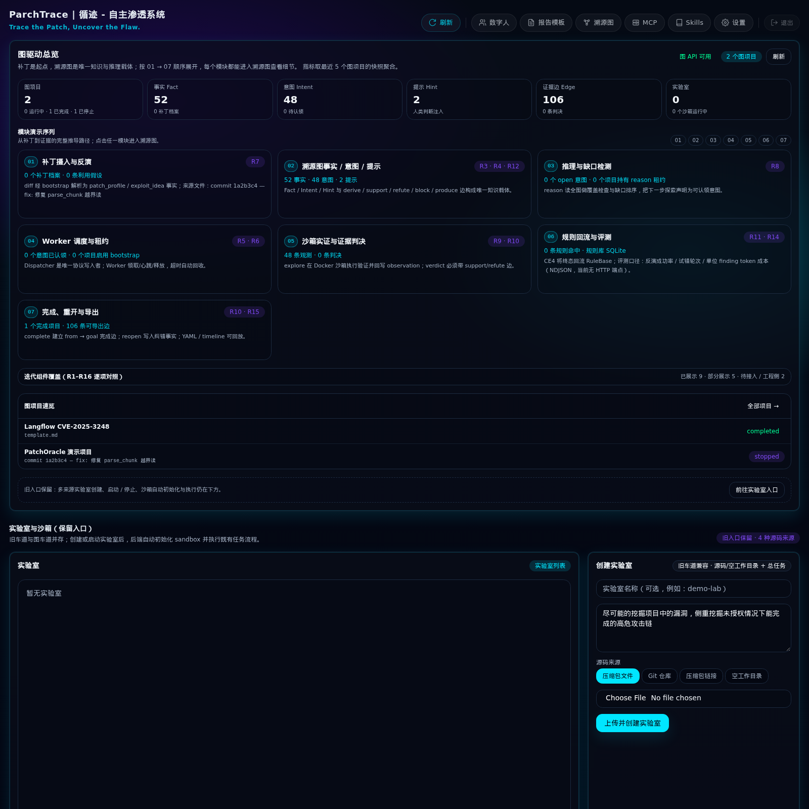
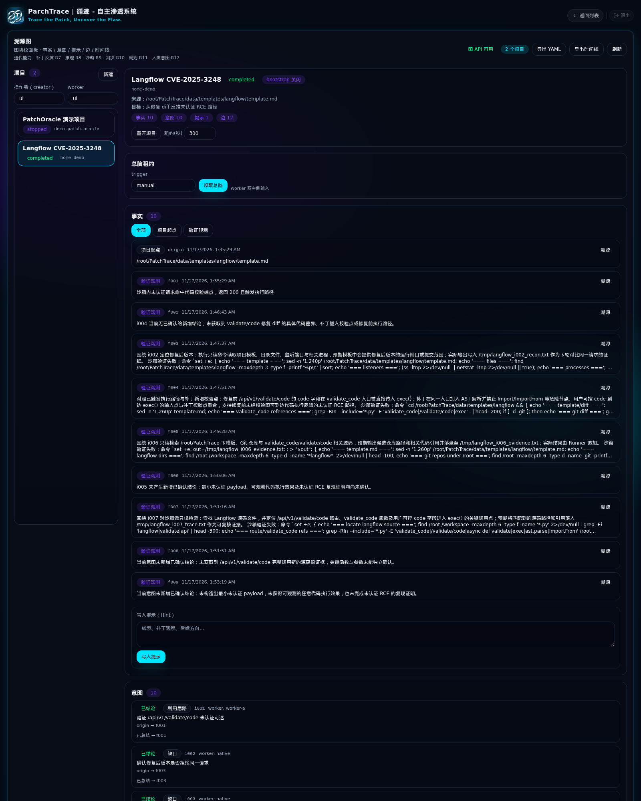

# ParchTrace | 寻迹 - 自主渗透系统

> **Trace the Patch, Uncover the Flaw.**
> **寻迹补丁，洞见漏洞。**

ParchTrace 是一个**补丁和图驱动的自主渗透系统**。它从厂商修复 diff 出发，反演出漏洞成立所需的约束，把事实、意图和证据写成一张可追溯的溯源图，再由 Worker 在隔离沙箱中逐条实证。只有能沿图回溯到项目起点的结论，才会成为 Finding。

它不把“让 Agent 自由发挥”当成能力，也不把扫描器输出当成结论。每一步都要留下可复核的节点与边。

---

## 为什么从补丁开始

| 补丁提供的信号 | 系统如何利用 |
|---|---|
| 厂商修复只触及真实可达的代码路径 | 用 diff 缩小搜索面，而不是从全量代码重新猜漏洞 |
| 修复前后语义差异暴露缺失的校验条件 | 反演出 `condition / harm / evidence` 三元组，形成可检验约束 |
| 修复提交带有版本、文件和上下文 | 生成 `patch_profile` Fact，作为整张溯源图的起点 |
| 约束可以被证实，也可以被证伪 | 在沙箱中执行验证；拒绝、超时、证据不足都落客观结论 |

因此，ParchTrace 的默认路径不是“扫一遍代码然后写报告”，而是：

```text
patch diff
  → 修复语义反演
  → 漏洞约束与利用假设
  → 溯源图上的信息缺口
  → 沙箱实证
  → support / refute 判决
  → 带完整推导路径的 Finding
  → 规则回流到下一次反演
```

---

## 核心闭环

| 阶段 | 做什么 | 主要产出 |
|---|---|---|
| **Patch ingest** | 解析 unified diff，提取文件、函数、行为变化 | `patch_profile` Fact |
| **Semantic inversion** | 反演修复语义，推导漏洞成立条件与危害 | `constraint`、`exploit_idea` Fact |
| **Bootstrap** | 补丁摄入 + 语义反演，写入首批事实与探索意图 | 初始溯源图 |
| **Reason** | 读全图，检查目标覆盖、排序证据缺口，声明下一步 Intent | 新 Intent 或 `noop` |
| **Explore** | 认领 Intent，在 Docker 沙箱执行验证，回写结果 | `observation`、`verdict` Fact |
| **Complete** | 检查 Finding 是否能沿 `origin → … → finding` 回溯 | `goal` 边、可导出的完成链 |
| **Rule feedback** | 将确认或反证结果回流规则库 | 新规则版本、置信度与命中计数 |

规则演化是一个闭环：`explore` 的终态经 CE4 回流到 `patchintel` 规则库；下一次 `bootstrap` 读取 top-k 规则，并把它们作为提示注入反演过程。

---

## 系统能力

### 补丁语义反演

- 支持 unified diff 摄入，保留文件、函数、上下文和变更方向。
- 将“删掉了哪个检查”“换了哪个比较”“新增了哪个边界”翻译成可利用条件。
- 同时生成漏洞约束和候选利用假设，而不是只生成一段自然语言摘要。
- 四个补丁工具已挂载到 Agent：补丁摄入、语义反演、规则查询、规则提升。

### 溯源图是唯一知识载体

- **Fact**：已确认的客观事实，只增不改。
- **Intent**：声明式信息缺口，可被 Worker 认领；生命周期为 `open → claimed → concluded`。
- **Hint**：图外人工判断，下次读图时被吸收；用于注入约 100 tokens 的经验，而不是注入方法。
- **Edge**：`produce`、`derive`、`support`、`refute`、`block` 等有向关系构成 DAG。
- SQLite 持久化，`graph.db` 与配置库分离；支持快照、溯源链和 YAML / timeline 导出。

### 平等 Worker 与租约

- 三类任务：`bootstrap`、`reason`、`explore`。
- Dispatcher 只负责选任务、选健康 Worker、续租、超时与并发上限；流程分支不写进 prompt。
- 原子认领：同一 Intent 同时只能有一个 Worker 成功。
- Lease 超时自动回到 `open`，Worker 崩溃不会永久卡死图。
- 项目级 `reason` 租约保证同一项目同时只有一个推理者。
- `block` 边不允许成环；依赖未解决的 Intent 不会被错误推进。

### 沙箱实证，而不是文本判定

- 复用 Docker 沙箱执行验证命令，支持多语言运行环境和 MySQL / Redis 等中间件。
- `explore` 先写入 `observation`，再由证据源产生 `verdict`。
- `verdict` 必须是 `support` 或 `refute`，并带 `support` / `refute` 边。
- 网络错误、命令失败、证据不足不会被当成“验证成功”；失败也写客观 Fact。
- 没有溯源路径的 Finding 不能完成项目；`reopen` 可以撤销错误完成并写入纠错事实。

### 人类判断可以进入图，但不能绕过闸门

- 通过 Hint 写入人工线索、优先级和后续方向。
- Hint 会影响下一次 `reason` / `explore` 的读图结果，但不直接伪造 Fact 或 Verdict。
- 高风险宿主机命令和目标动作仍受审批流程控制；`-auto-mode full` 是显式自动化开关。

### 图驱动 UI 与旧实验室并存

- 首页展示图项目总览、事实/意图/提示/边统计、模块覆盖矩阵和最近项目。
- 溯源图面板支持新建项目、状态切换、完成/重开、Hint、Intent 声明/领取/心跳/释放/总结、总脑租约、YAML 导出、timeline 和 provenance 追溯。
- 事实列表支持按类型过滤，模块卡片会带着项目与事实类型直接进入对应视图。
- 旧实验室入口完整保留：压缩包文件、Git 仓库、压缩包链接、空工作目录四种源码来源，以及启动、停止、删除、进入项目、自动初始化沙箱和执行既有任务流程。

---

## 溯源图数据模型

```text
Project
  ├─ origin fact
  ├─ Fact      patch_profile | exploit_idea | constraint
  │             observation | verdict | rule_hit
  ├─ Intent    open | claimed | concluded
  ├─ Hint      human judgment
  └─ Edge      produce | derive | support | refute | block
```

- 项目状态：`active`、`stopped`、`completed`；`completed` 只能通过 `reopen` 撤销。
- Intent 认领需要 worker 与 lease；超时释放会清空 worker。
- `complete` 至少需要一个 `from` Fact；每个 Fact 必须能 Provenance 回 `origin`。
- 图导出支持 YAML 快照和 process timeline，便于审计与回放。

---

## 架构

```text
┌──────────────────────────────────────────────────────────────┐
│ React Web UI                                                 │
│ 图总览 · 溯源图面板 · 实验室 · 数字人 · 报告模板 · 设置      │
└──────────────────────────┬───────────────────────────────────┘
                           │ /api/graph + Bearer Token
┌──────────────────────────▼───────────────────────────────────┐
│ graphserver/  图协议 HTTP 层                                  │
│ graph/        Fact / Intent / Hint / Edge + SQLite graph.db  │
└──────────────────────────▲───────────────────────────────────┘
                           │ 进程内协议客户端
┌──────────────────────────┴───────────────────────────────────┐
│ dispatch/     调度核心                                        │
│  bootstrap · reason · explore · lease · worker · timeout     │
└───────────────┬──────────────────────────────┬───────────────┘
                │                              │
       ┌────────▼────────┐            ┌────────▼──────────────┐
       │ patchintel/     │            │ dockerManager/        │
       │ diff / invert / │            │ sandbox / services    │
       │ rule base       │            │                       │
       └─────────────────┘            └───────────────────────┘

旧车道（保留兼容）：Web → LabManager 总脑 → 三个研究组 → DecisionBrain
                    → agents 数字人池 → toolCalling → llm / docker
```

| 目录 | 职责 |
|---|---|
| `patchintel/` | 补丁摄入、语义反演、规则库 |
| `graph/` | 节点、边、租约、完成闸门、溯源查询、YAML / timeline 导出 |
| `graphserver/` | `/api/graph` 协议路由与 HTTP client |
| `dispatch/` | 调度器、三类任务、Worker driver、沙箱 runtime、CE4 回流 |
| `dockerManager/` | Docker sandbox、语言环境、服务管理 |
| `Web/` | gin HTTP / WebSocket、认证、项目启动队列、图路由挂载 |
| `agents/` | 旧车道的持久化 Agent 能力与数字人构造 |
| `toolCalling/` | 工具注册、参数校验、审批、MCP |
| `llm/` | Chat Completions / Responses / Anthropic Messages 客户端 |
| `webui/` | React + Vite 前端，构建后嵌入单二进制 |
| `docs/runbooks/` | 端到端演示与验收手册 |

---

## 快速开始

### 前置条件

- Go 1.24.1+
- Node.js / npm
- 可用的 Docker daemon
- 一个兼容 OpenAI Chat Completions、OpenAI Responses 或 Anthropic Messages 的模型服务

### 构建与启动

前端必须先构建，`main.go` 通过 `//go:embed all:webui/dist` 把 UI 打进二进制：

```bash
cd webui
npm install
npm run build
cd ..

CGO_ENABLED=0 go build -o ParchTrace .
./ParchTrace -port 9999
```

常用启动方式：

```bash
# 指定端口
./ParchTrace -port 8080

# 指定 Agent Tools 对外可访问 IP
./ParchTrace -port 9999 -ip 192.168.1.10

# 显式开启全自动模式
./ParchTrace -port 9999 -auto-mode full
# 等价写法
./ParchTrace -port 9999 -full-auto

# 指定 MCP 配置文件
./ParchTrace -port 9999 -mcp-config /path/to/mcp.json
```

首次启动：

1. 打开 `http://<host>:9999`，进入初始化向导。
2. 创建管理员账户，按提示构建 `aisandbox` 与 `java_env` 镜像。
3. 在「设置」中填写 `main_setting.BASE_URL`、`main_setting.OPENAI_API_KEY`、`main_setting.MODEL`。
4. 进入首页创建实验室，或启用图车道后创建图项目。

`BASE_URL` 兼容 OpenAI 格式服务；设置 `API_MODE=anthropic`（或 `claude`）可直连 Anthropic Messages API。

---

## 启用图车道

图车道是显式 opt-in，默认关闭；关闭时仍是原有 TotalBrain 闭环，行为不变。

### 1. 打开开关

可在 Web「设置」的 `[misc]` 分组修改，或在服务停止时直接写配置库：

```bash
sqlite3 data/AIxVuln.db "
INSERT INTO config(section,key,value) VALUES('misc','graph_lane_enabled','true')
ON CONFLICT(section,key) DO UPDATE SET value=excluded.value;"

sqlite3 data/AIxVuln.db "
INSERT INTO config(section,key,value) VALUES('misc','graph_lane_config','dispatch.yaml')
ON CONFLICT(section,key) DO UPDATE SET value=excluded.value;"
```

只有 `true` / `1` / `yes` / `on`（大小写不敏感）会启用车道。

### 2. 准备 `dispatch.yaml`

默认读取仓库根目录的 `dispatch.yaml`：

```yaml
server: http://127.0.0.1:9999
runtime:
  max_workers: 4
  max_running_projects: 2
  max_project_workers: 3
  interval: 5s
  healthcheck_timeout: 30s
  prompt_group: default
tasks:
  bootstrap:
    timeout: 20m
    conclude_timeout: 5m
  reason:
    timeout: 10m
  explore:
    timeout: 15m
    conclude_timeout: 5m
```

缺少必填键时车道拒绝启动，并写入警告日志；旧车道不受影响。

### 3. 数据与降级

默认数据路径：

```text
data/AIxVuln.db             配置、数字人、MCP 等
data/graph.db               溯源图
data/patchintel/rules.db    补丁规则库
```

`misc.DATA_DIR` 可以改数据根目录；`AIXVULN_DATA_DIR` 只影响配置库打开位置，且必须在配置单例初始化前设置。

如果模型尚未配置，图车道会退化为 **GraphOnly**：挂载 `/api/graph` 和 UI，不启动调度；配置模型后重启即可开始 bootstrap / reason / explore。

### 4. 图项目与沙箱的关系

`explore` 不自己创建靶标。它复用既有实验室生命周期注册的 sandbox，因此：

- 图项目 ID 必须与已启动 lab 的 ID 完全一致。
- 先通过实验室页面或 `/projects` API 创建并启动 lab，等待 `sandboxContainerID` 非空。
- 如果旧车道的总脑仍在运行，先停止 lab，仅保留 sandbox 注册关系，避免两套调度同时操作同一沙箱。
- 靶标必须能从 sandbox 内部访问；“宿主机能 curl 通”不等于验收通过。

完整步骤见 [`docs/runbooks/cve-2025-3248.md`](docs/runbooks/cve-2025-3248.md)。

---

## 使用流程

1. **创建实验室**：在首页「实验室与沙箱」选择压缩包文件、Git 仓库、压缩包链接或空工作目录，填写任务目标并创建。
2. **启动实验室**：等待 Docker sandbox 初始化；在项目详情中确认沙箱容器 ID。
3. **创建图项目**：在图面板新建项目，`id` 使用 lab ID，`origin` 指向补丁文件，`goal` 写清验收目标，按需开启 bootstrap。
4. **观察反演**：bootstrap 写入 `patch_profile`、`exploit_idea`，并声明第一批 inversion Intent。
5. **推进推理**：reason 读取整图，补齐缺口；explore 领取 Intent，在沙箱中执行验证并写回 observation / verdict。
6. **人工介入**：需要补充经验时写 Hint；需要撤销错误完成时使用 reopen。
7. **导出与审计**：导出 YAML 或 timeline，检查 Finding 是否具有完整的 `origin → … → goal` 路径。

### 图协议 API

所有 `/api/graph` 请求使用 Bearer Token 认证：

| 方法与路径 | 用途 |
|---|---|
| `POST /api/graph/projects` | 创建图项目 |
| `GET /api/graph/projects` | 列出项目 |
| `GET /api/graph/projects/:id` | 读取项目状态 |
| `PUT /api/graph/projects/:id/status` | 停止 / 恢复项目 |
| `POST /api/graph/projects/:id/reopen` | 撤销错误完成 |
| `POST /api/graph/projects/:id/hints` | 写入人工提示 |
| `POST /api/graph/projects/:id/intents` | 声明 Intent |
| `POST /api/graph/projects/:id/intents/:iid/{heartbeat,release,conclude}` | 认领生命周期与结论 |
| `POST /api/graph/projects/:id/reason/{claim,heartbeat,release}` | 项目级推理租约 |
| `POST /api/graph/projects/:id/complete` | 完成项目（校验溯源路径） |
| `GET /api/graph/projects/:id/snapshot` | UI 快照 |
| `GET /api/graph/projects/:id/provenance` | 单节点溯源链 |
| `GET /api/graph/projects/:id/export?format=yaml\|timeline` | 导出图或时间线 |

只读查询和 UI 渲染不需要启动调度器；写入与任务执行需要模型配置和可用的 Docker 环境。

---

## 旧车道：保留的实验室体验

ParchTrace 不是对旧系统的替换式重写。图车道与旧车道并行存在：

- **多来源建项目**：压缩包文件、Git 仓库、压缩包链接、空工作目录。
- **项目生命周期**：创建、启动、停止、删除、进入项目。
- **自动环境准备**：启动后自动初始化 sandbox，执行环境搭建、代码审计、验证和报告流程。
- **多 Agent 协作**：总脑、三个研究组、决策大脑、数字人池、团队聊天和跨组协作。
- **既有工具与审批**：MCP、Skills、宿主机命令审批、目标动作审批、报告模板。
- **共享沙箱**：二进制 / 渗透组通过 runtime alias 使用同一 lab 的 Docker 资源。

图车道关闭时，以上行为与改造前保持一致。图车道开启时，旧入口仍保留，但不要同时驱动同一个 lab 的 sandbox。

---

## 开发与测试

```bash
# 图车道核心测试（离线，不依赖真实 Docker / LLM）
go test ./graph/ ./graphserver/ ./dispatch/... -race

# 全量测试
go test ./...

# 前端类型检查与构建
cd webui && npx tsc --noEmit && npm run build && cd ..

# 发布版
./build_all.sh
```

图相关测试使用 `t.TempDir` 和 fake client / fake driver；配置库是进程单例，隔离测试需在首次配置访问前设置 `AIXVULN_DATA_DIR`。

---

## 安全边界

ParchTrace 会启动并控制 Docker 容器，执行目标动作，并调用模型服务。只在**你拥有或获得明确书面授权**的环境中使用。

- **授权范围**：不要对公网或第三方目标发起未授权测试。
- **网络隔离**：不要把 `:9999` 直接暴露到公网；使用防火墙、反向代理或内网访问控制。
- **Docker 权限**：Docker socket 等价于宿主机高权限，建议在专用主机或隔离网络中运行。
- **凭据保护**：模型密钥、管理员凭据、MCP 配置和项目数据保存在 `data/`，请限制目录权限。
- **会话安全**：Bearer Token 使用进程随机密钥签名，服务重启后所有会话失效；请使用强管理员口令。
- **审批纪律**：高风险宿主机命令和目标动作默认需要人工批准；`-auto-mode full` 只应在可回滚、可隔离的验收环境中使用。
- **数据外发**：Agent 会把代码与执行上下文发送给你配置的模型服务；请确认数据合规要求。
- **不保证结果**：系统输出是待复核的安全结论；任何 Finding 都应由人工在授权范围内复核。

---

## 当前状态

- 图车道默认关闭，属于显式灰度能力；旧车道保持可用。
- 图协议、溯源面板、租约、完成闸门、规则回流和 CVE-2025-3248 runbook 已落地。
- 真实目标的完整验收需要 Docker 靶标、模型配置和人工执行 runbook；仓库不附带真实漏洞利用结果。
- Finding 的证据链以溯源图和 timeline 为准；报告模板与旧车道报告仍从既有 Web UI 管理。

## License

MIT，详见 [`LICENSE`](LICENSE)。

---

## 实际界面

以下截图来自本仓库本地构建的实际运行实例（演示数据：`probe-*` 图项目），不是设计稿或生成图。




