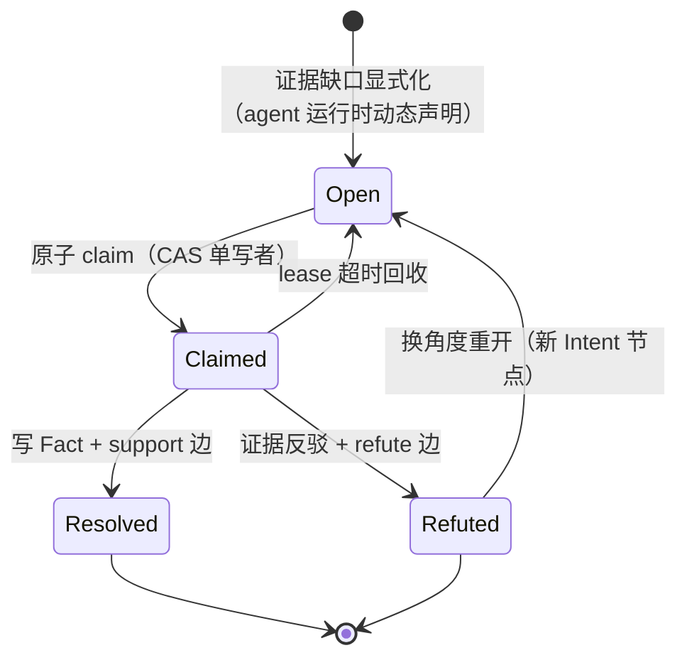
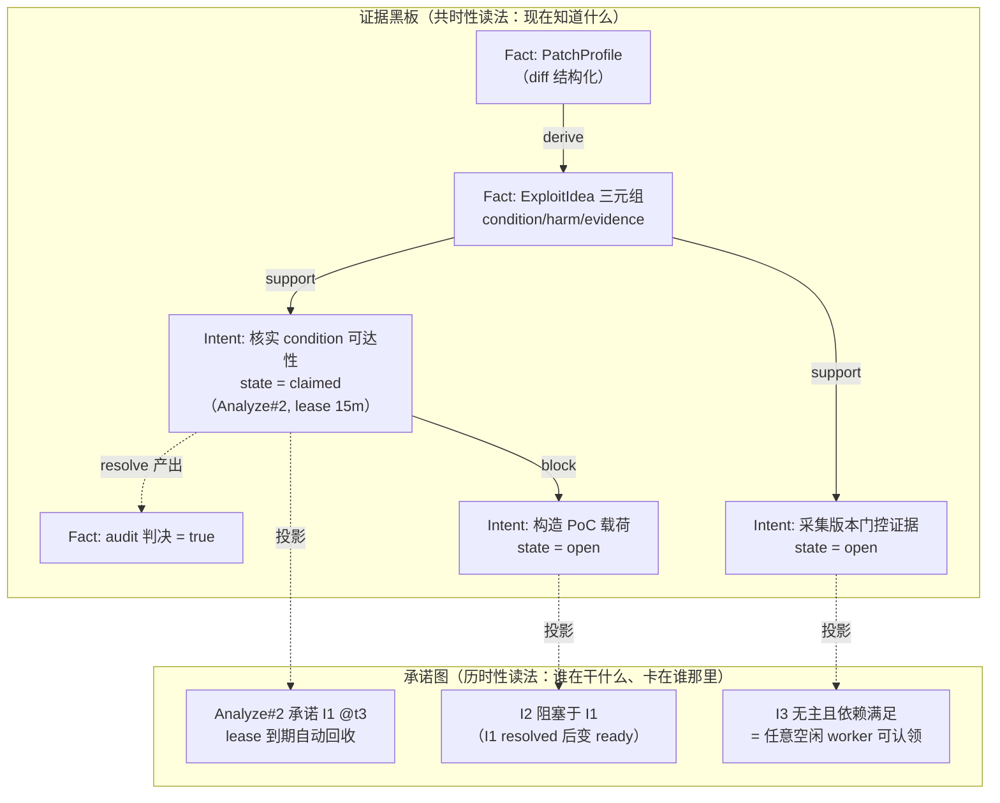
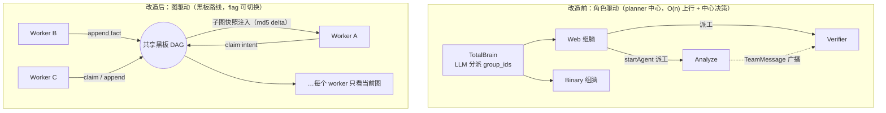

# Graph Engineering 改造设计：三图一池一通道（AIxBreak 编排层升级）

- 日期：2026-10-14
- 状态：已批准蓝图（会话内 ExitPlanMode 通过），待人工 review
- 关联 spec：`方案-实例反证闭环`
- 命题输入：`requiement.md`（cairn 式架构四段论）
- 推理依据：《Hackers or Hallucinators》评测结论、`3.AIxBreak-Native+图工程+反证约束-方案.pdf`、Less_Than_Nothing_AI攻防复盘报告.pdf`、`4.AIxBreak-改动方向解析+重构图解析.pdf`（content4.json 为内容真源）

## 1. 问题与目标

**现状**：三层中心化 Hub-and-Spoke（Web → LabManager 总脑 → DecisionBrain 组脑 → agents），总脑一次 LLM tool-call 做 group_ids 枚举分派（`LabManager/LabManager.go:1364 planDispatchByTotalBrain`）。评测与内部复盘均表明 planner 式多 agent 易负优化：角色边界模糊、冗余决策冲突、通信信息丢失、记忆碎片化。

**目标**：协作从角色驱动改为图驱动。为两个维度各设计一张对的图：

- **共时性**（某一时刻跨所有 agent 的共享知识结构）
- **历时性**（跨时间的推理历史与演化结构）

让图状态承担协调，planner 降级为可回退的兼容车道。

**原文依据**（防"外来理念"质疑）：

- 三源合流报告 p19："Blackboard（Fact / Intent / Hint 三元素）+ Worker 平等无角色 + Stigmergy 间接协调，通信复杂度从 O(n²) 降到 O(n)。Agent 每次只看当前图"
- 三源合流报告 p17："协作应由图 / 证据驱动，不是角色驱动"；p37："把协作做成可演化的图，把判断做成可证伪的闸门"
- Less_Than_Nothing p12：以"信息充分"的自然语言边替代布尔判断，AI 既是执行者又是路由器；p16-17："不编码多 Agent 的组织方式，只给 Toolset"
- 融合改造方案 §2.3：CE1-CE6 显式边表，谓词在结构化状态上求值不进提示词，行为等价
- Hackers or Hallucinators：赢家 = 多个独立单 agent 并行（CTFSOLVER）或共享结构化记忆（LuaN1ao 任务图+因果图）；关键是任务边界、冲突控制、记忆结构，不是单 vs 多

## 2. 目标架构：三图一池一通道

```
┌─────────────────────────────────────────────────────────────┐
│ 模型侧（不变）：理解约束 · 生成方案 · 给出判断                     │
└─────────────────────────────────────────────────────────────┘
        ↑ 读：graph-as-context（子图快照注入）      ↓ 写：claim/append 工具
┌─────────────────────────────────────────────────────────────┐
│ 图 1 证据黑板 DAG（共时性）— cairn fact/intent/hint            │
│   Fact: PatchProfile / ExploitIdea 三元组 / 沙箱观测 / audit 判决 │
│   Intent: 信息缺口节点（可 claim 的工作单元）                     │
│   Hint: 人工意图(~100 tokens) / 场景模板                        │
├─────────────────────────────────────────────────────────────┤
│ 图 2 条件边工作图（历时性）— patchflow CE1-CE6 边表              │
│   谓词在图 1 状态上求值 → 每次转移 append 到事件溯源图日志          │
├─────────────────────────────────────────────────────────────┤
│ 图 3 规则信息素图（历时性，跨 run）— RuleBase 版本 DAG            │
│   规则=节点，版本链=边，hit_count/confirm_count=信息素强度         │
├─────────────────────────────────────────────────────────────┤
│ Worker 平等池（数字人对象池，原样复用 Base.go:913-990）           │
│   协调 = 图状态即指令：无主 Intent + 依赖满足 → 任意 worker 可认领  │
│   兼容车道：TotalBrain LLM 分派保留（flag 门控，行为等价默认路径）   │
└─────────────────────────────────────────────────────────────┘
```

### 2.1 图 1：证据黑板（唯一的新结构）

**雏形泛化，不是另起炉灶**：`DecisionBrain.exploitIdeaList`（`Base.go:91-92`）+ `ExploitStore`（`ExploitStore.go:18-77`）已具备黑板四要素——字符串 ID（E.x/C.x）寻址、State 字段、唯一写入口 handler、按 ID 检索 + 面板广播。缺的只是：节点间边、intent/hint 节点类型、claim 语义。

- **数据模型**：新增 `blackboard/` 包。`Node{id, kind: fact|intent|hint, type, content, state, claimed_by, created_at}`；`Edge{from, to, kind: derive|support|refute|block}`。
- **落库**：挂既有 `exploits.db`，照抄 ExploitStore 的 migrate 模式（WAL + MaxOpenConns(1)）；`exploit_idea`/`exploit_chain` 表增 `omitempty` 图 ID 字段保持兼容。
- **写入口**：三个既有 handler（`Base.go:1313/:1453/:1489`）之外旁路新增；黑板工具走 `RegisterExternalTool`（`Base.go:1188`）或工厂尾部 append，绝不触碰 `factories[:7]`（agent_builder.go:149）/ `factories[:12]`（:257）。
- **共时性语义**：任意时刻黑板拓扑 = 全体 agent 的共同知识状态。auditEvidence 判决、沙箱终态、规则命中都以 fact 节点落图。

### 2.2 图 2：条件边工作图（= patchflow，谓词求值对象升级）

- CE1-CE6 边表（四元组 源/条件谓词/目标/动作）不变；谓词求值对象从散落字符串状态改为图 1 状态：`auditEvidence==true` ≈ 黑板存在 support 边指向该 idea 的 audit-fact；CE3 证据不足 ≈ evidence-fact 缺失或被 refute。
- **历时性**：每次边触发 append 一条事件到图日志（落点 `DecisionBrain/Runtime.go:212` WebMsg 处，append-only 因果链）→ 报告、审计、回放三合一，满足判定纪律的证据链要求。

### 2.3 图 3：规则信息素图（= RuleBase 的图形态读法）

- rules 表（2026-10-12 spec :181-196：version 化、hit_count/confirm_count、top-k）即蚁群信息素图：规则=节点，version 链=历时边，命中/确认计数=信息素强度；CE4 回流=信息素增减，CE5 top-k=按信息素选路，CE6 模板=零信息素兜底。
- Less_Than_Nothing p17 "记忆/知识库收益存疑"的警告 → 不预先下结论，由 patcheval 双条件对照直接检验（诚实边界）。

### 2.4 一池：Worker 平等 + claim 协调（从调度到协调）

- **不删 planner，加车道**：TotalBrain 分派原样保留为默认路径（行为等价）；新增黑板车道——组脑循环（`Start.go:31-179`）每次唤醒先查黑板：无主且依赖满足的 Intent → 按 `ExploitAutomationPolicy` 同款策略自动派发或等 worker 原子 claim（SQLite 单写者防竞争）。车道开关走 misc config 段，默认关。
- **graph-as-context 读通道**：`BrainMemory` 新增 `blackboardJson` 分节（`omitempty`，复用 `lastPanelSectionHash` md5 delta 去重）；agent 侧复用 `AddKeyMessage(EnvMessageX)` 注入点，startAgent 注入序列（`Base.go:1734-1742`）加黑板子图快照（本人认领 Intent + support 子图，摘要级不刷屏）。
- 结构性修复 Less_Than_Nothing p21-22 四道未解题的共同根因（"关键信息未进入 Agent 上下文"）：关键信息要么在图上，要么有边指向它。

## 3. 第二种图结构：Commitment Graph（用于ACI·算法创新赛）

cairn 黑板是**知识结构**（共时性：现在知道什么）。本设计给出的第二种结构是**承诺结构**：**Commitment Graph（承诺/认领图）**——历时性主导的协调结构。

### 3.1 算法创新定位（参赛）

**一句话声明**：把多 agent 协调问题归约为**共享 DAG 上的图状态收敛问题**——worker 是自调度的图读取者，协调协议的安全性/活性由图不变量保证，不需要中心 scheduler。

**算法核心性质**（可验证，不是修辞）：

| 性质 | 机制 | 验证方式 |
|---|---|---|
| 安全性（无双认领） | claim = 共享节点状态上的原子 CAS（SQLite 单写者 WAL，MaxOpenConns(1)） | `-race` 下两 goroutine 抢同一 intent，恰一人成功 |
| 无死锁 | block 边强制无环：写 block 边时做环检测，成环即拒绝写入 | 环检测单元测试（A→B→C→A 拒绝） |
| 活性（工作保守） | 任一"无主 + 依赖满足"的 intent 在存在空闲 worker 时终被认领（lease 超时回收防饿死/挂死） | lease 超时回收测试 |
| 可审计（历时性） | 每次生命周期转移 append 到事件溯源图日志 → 承诺历史可回放 | 图日志重放一次完整挖掘（§6.5） |

**相对现有工作的 delta**（评委追问口径，不空喊"全新"）：

| 先例 | 它有什么 | 我们的增量 |
|---|---|---|
| cairn 黑板（Fact/Intent/Hint） | 知识共享、stigmergy 协调 | cairn 论文口径未给出认领的生命周期状态机与原子语义；我们给 intent 节点加了 open→claimed→resolved/refuted 生命周期 + CAS + lease |
| 蚁群信息素（Less_Than_Nothing p12） | 边权强化路径 | 信息素是标量反馈；承诺图是**责任归属**结构（谁认领、阻塞于谁、何时到期），可回放可追责 |
| LuaN1ao 任务图+因果图 | 共享结构化记忆 | 其任务图是静态分解产物；我们的 intent 由 agent 运行中动态声明，且知识/工作/审计统一在同一种节点结构上（kind + state 两个字段），一个库三个读法 |
| 传统 DAG 工作流引擎 | 依赖调度 | DAG 引擎的节点是预先编码的任务；我们的节点是 LLM 运行时声明的高价值信息单元，"既是知识又是工作" |

**诚实边界**：不声称推翻 cairn——这是 cairn 黑板在**协调语义维度**的补全（黑板回答"知道什么"，承诺图回答"谁在干什么、卡在谁那里、到期没"）；同样的对照消融口径（[1]Native+图工程+反证约束 p10：重复任务率/误报率/单位 finding token 成本）用于验证其有效性，不预先声明胜负。

### 3.2 机制定义

- 节点 = Intent 生命周期态（open → claimed → resolved/refuted）；边 = 依赖（blocked-by）、承诺（who claimed what at when, lease 到期时间）、产出（resolve 后指向新 fact）。
- 协调无 planner：worker 下一步完全由图状态决定——查无主 ready Intent → 原子 claim → 干完写 fact 解析。Stigmergy 的工程化（"图上的当前状态就是最好的指令" [2]Native+图工程+反证约束 p19-20）。
- 治多 agent 四通病的机制映射：角色边界模糊 → claim 显式化边界；决策冲突 → 原子 claim 消重；信息丢失 → 依赖边显式化；记忆碎片化 → 承诺历史入图日志。
- **落点**：第三张图不用新建——Commitment Graph 就是图 1 intent 节点的生命周期视图 + 图 2 事件日志的投影，同一份数据两个读法。

### 3.3 结构图（mermaid）

**① Intent 生命周期状态机（承诺图的状态空间）**：



**② 同一份数据的两个读法（知识结构 ⇄ 承诺结构）**：



**③ 协调方式对比（创新点叙事图）**：



备选答案记录：MTP 式记忆图（token 降 98.7%，三源报告 p17）是压缩技术非协作结构；蚁群信息素图已并入图 3。

## 4. 与 13 任务实施计划（2026-10-12-patch-oracle.md）的融合

**12 任务一个不删**；4 个升级表述 + 1 个新增：

| 任务 | 调整 |
|---|---|
| Task 1-3（git init / resource stub / skill stub） | 不变（前置地基） |
| Task 4 PatchIngest | 不变；PatchProfile = 黑板首个 fact 节点类型 |
| Task 5 RuleBase | 升级表述为规则信息素图（schema 不变） |
| Task 6 SemanticInverter | 不变；CE5/CE6 读图 3 |
| Task 7 四工具挂载 | 不变（尾部 append 红线内） |
| Task 8 场景模板 | 模板 = 黑板 hint 节点静态来源 |
| Task 9 意图注入点 | 人工意图 = hint 节点入图；HumanIntent 字段保留兼容 |
| Task 10 patchflow 边表 | 先按原计划落地（对 ExploitIdea 状态模型求值，CE 真值表验收）；Task 13 落黑板后加薄适配层，使同一批谓词可对图 1 状态求值 + 事件溯源图日志 |
| Task 11 patcheval | 升级：双条件（冷启动/预置 N≥3）之外加可选第三对照（黑板车道 vs TotalBrain 车道；落三源报告 P10 成功标准：重复任务率/误报率/单位 finding token 成本） |
| Task 12 部署验收 | 不变 |
| **Task 13（新增）** | `blackboard/` 包：节点/边模型 + SQLite 落库 + claim 原语 + 读写工具（尾部挂载）+ `blackboardJson` 分节注入 |

## 5. 改动纪律合规

- 新增文件：`blackboard/`、`patchflow/`（计划内）、图日志 writer。
- 工厂尾部 append：黑板读写工具；`factories[:7]` / `factories[:12]` 下标块不触碰。
- `omitempty` 字段：ExploitIdea/ExploitChain 图 ID、Task 事件链、BrainMemory.blackboardJson、HumanIntent。
- 既有函数体最小增量仅两处（实施计划中单列并停下汇报）：startAgent 注入序列加一行黑板快照（Base.go:1734-1742 附近）；Runtime.go:212 WebMsg 处加 append。
- 黑板车道 flag 默认关 → 行为等价；单二进制 + SQLite 不变，无新存储引擎。

## 6. 验证

1. 编译绿闸门：`go build ./...`（Task 1-3 后全库可编译）。
2. 行为等价：黑板车道关闭时跑既有闭环，exploits.db 记录、审计回路、报告产物与改造前可比对。
3. 黑板单元测试：claim 竞争（两 worker 抢同一 intent，`-race`）、DAG 环检测、delta 注入只触发一次。
4. CE 真值表：patchflow 求值器对图 1 状态的六条边真值表（2026-10-12 plan Task 10 验收原样）。
5. 端到端：CVE-2025-3248 跑通 反演→闸门→验证→回流；图日志可重放一次完整挖掘（三源报告 W1 DONE 标准）。
6. patcheval：双条件 N≥3 + 三指标 JSON；可选第三对照输出调度方式对比。

## 7. 风险登记（新增部分）

| 风险 | 应对 |
|---|---|
| 黑板车道与 TotalBrain 车道双重派发 | claim 原子性 + 车道互斥 flag；默认只开一条 |
| 图 1 快照注入撑大上下文 | 摘要级（节点计数 + 本人相关子图）+ md5 delta 只在变更时注入 |
| Task 13 挤占 11-01 材料时钟 | Task 13 排在 Task 10 后、Task 11 前；最小实现=ExploitStore 泛化 + 4 个尾部工具 + 1 个注入点 |
| 评测口径漂移 | patcheval 承诺不变：双条件 N≥3 + 三指标，只承诺口径与脚本，不承诺分数 |