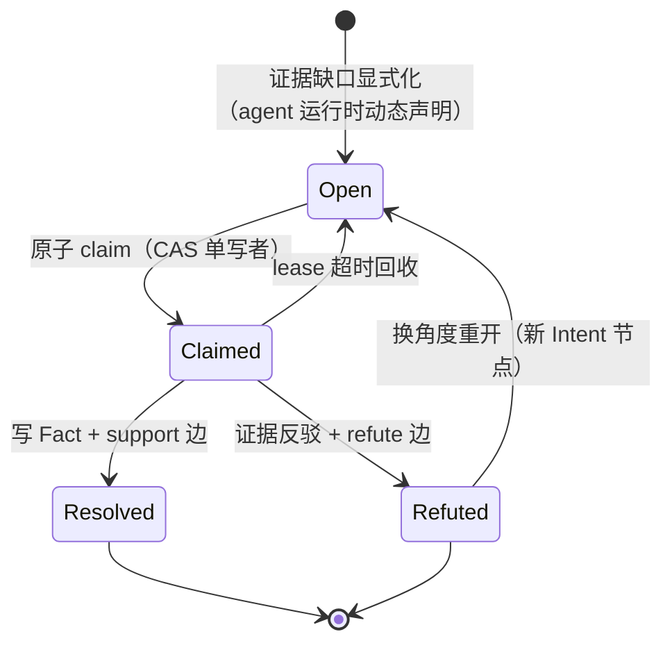
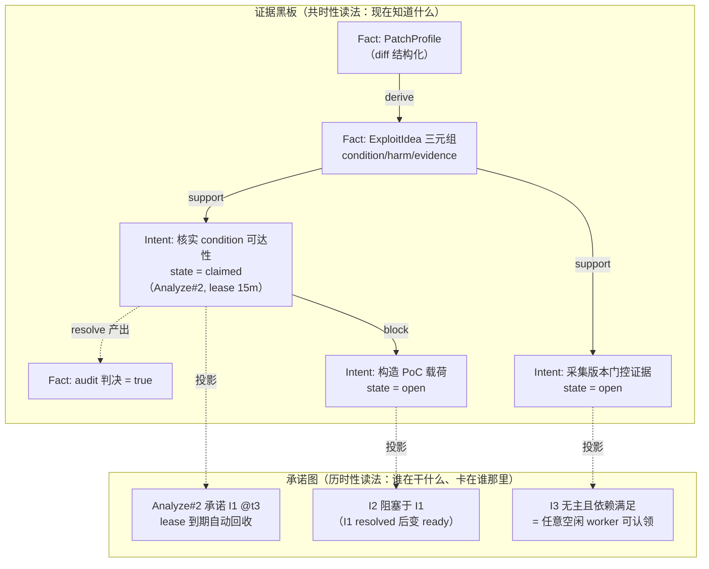
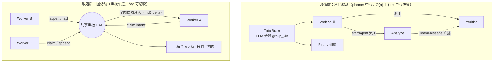
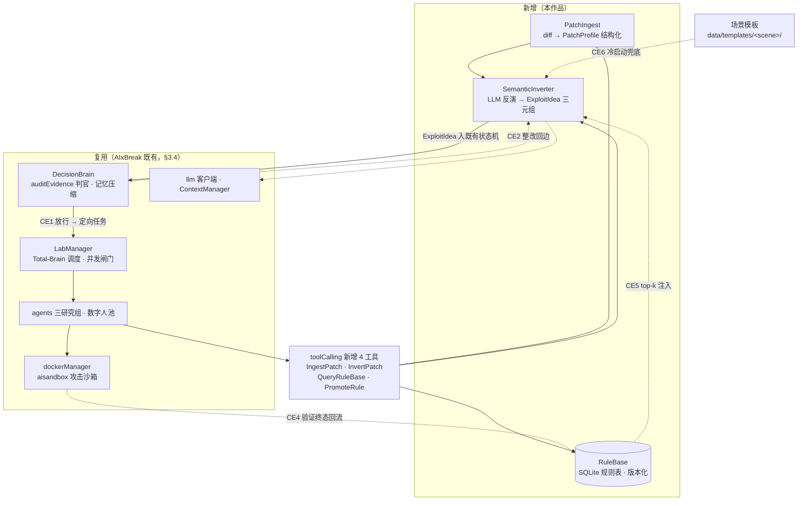
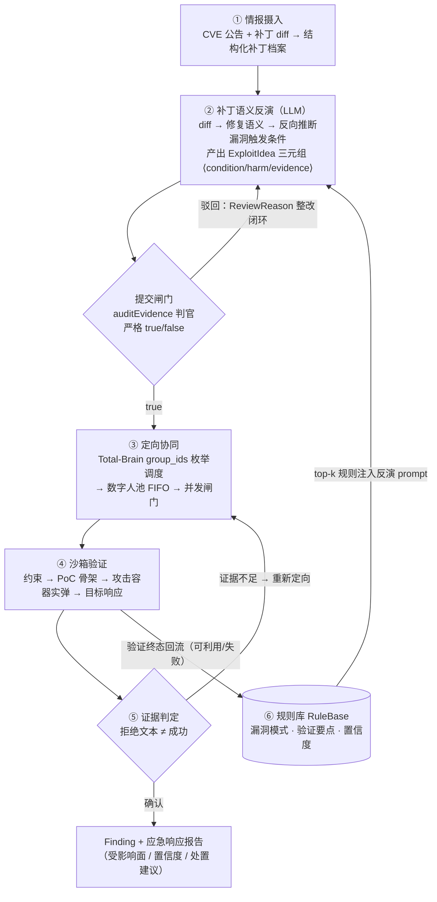
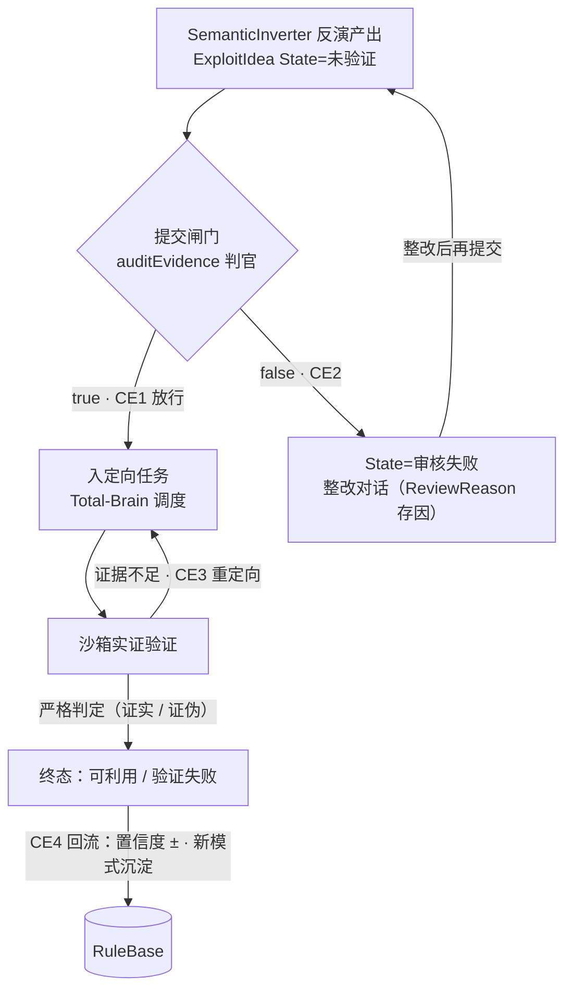
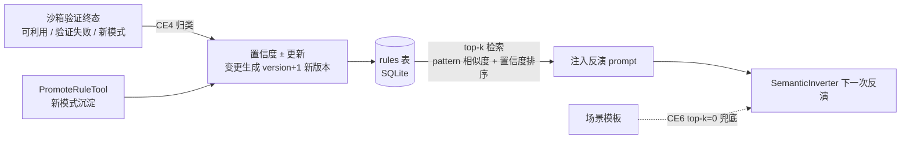
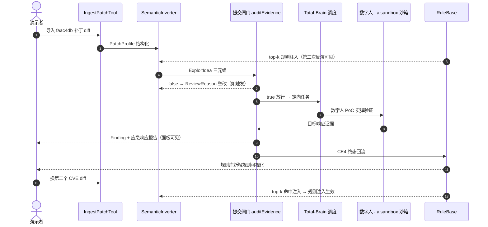

# Graph Engineering 改造设计：三图一池一通道（AIxBreak 编排层升级）

- 日期：2026-10-14
- 命题输入：`cairn架构
- 推理依据：《Hackers or Hallucinators》评测结论、`3.AIxBreak-Native+图工程+反证约束-方案.pdf`、`AIxBreak-改动方向解析+重构图解析.pdf`、`Less_Than_Nothing_AI攻防复盘报告.pdf`

## 1. 问题与目标

**现状**：三层中心化 Hub-and-Spoke（Web → LabManager 总脑 → DecisionBrain 组脑 → agents），总脑一次 LLM tool-call 做 group_ids 枚举分派（`LabManager/LabManager.go:1364 planDispatchByTotalBrain`）。评测与内部复盘均表明 planner 式多 agent 易负优化：角色边界模糊、冗余决策冲突、通信信息丢失、记忆碎片化。

**目标**：协作从角色驱动改为图驱动。为两个维度各设计一张对的图：

- **共时性**（某一时刻跨所有 agent 的共享知识结构）
- **历时性**（跨时间的推理历史与演化结构）

让图状态承担协调，planner 降级为可回退的兼容车道。

**原文依据**（防"外来理念"质疑）：

- 三源合流报告 p19："Blackboard（Fact / Intent / Hint 三元素）+ Worker 平等无角色 + Stigmergy 间接协调，通信复杂度从 O(n²) 降到 O(n)。Agent 每次只看当前图"
- 三源合流报告 p17："协作应由图 / 证据驱动，不是角色驱动"；p37："把协作做成可演化的图，把判断做成可证伪的闸门"
- Less_Than_Nothing p12：以"信息充分"的自然语言边替代布尔判断，AI 既是执行者又是路由器；p16-17："不编码多 Agent 的组织方式，只给 Toolset"
- 融合改造方案 §2.3：CE1-CE6 显式边表，谓词在结构化状态上求值不进提示词，行为等价
- Hackers or Hallucinators：赢家 = 多个独立单 agent 并行（CTFSOLVER）或共享结构化记忆（LuaN1ao 任务图+因果图）；关键是任务边界、冲突控制、记忆结构，不是单 vs 多

## 2. 目标架构：三图一池一通道

```
┌─────────────────────────────────────────────────────────────┐
│ 模型侧（不变）：理解约束 · 生成方案 · 给出判断                     │
└─────────────────────────────────────────────────────────────┘
        ↑ 读：graph-as-context（子图快照注入）      ↓ 写：claim/append 工具
┌─────────────────────────────────────────────────────────────┐
│ 图 1 证据黑板 DAG（共时性）— cairn fact/intent/hint            │
│   Fact: PatchProfile / ExploitIdea 三元组 / 沙箱观测 / audit 判决 │
│   Intent: 信息缺口节点（可 claim 的工作单元）                     │
│   Hint: 人工意图(~100 tokens) / 场景模板                        │
├─────────────────────────────────────────────────────────────┤
│ 图 2 条件边工作图（历时性）— patchflow CE1-CE6 边表              │
│   谓词在图 1 状态上求值 → 每次转移 append 到事件溯源图日志          │
├─────────────────────────────────────────────────────────────┤
│ 图 3 规则信息素图（历时性，跨 run）— RuleBase 版本 DAG            │
│   规则=节点，版本链=边，hit_count/confirm_count=信息素强度         │
├─────────────────────────────────────────────────────────────┤
│ Worker 平等池（数字人对象池，原样复用 Base.go:913-990）           │
│   协调 = 图状态即指令：无主 Intent + 依赖满足 → 任意 worker 可认领  │
│   兼容车道：TotalBrain LLM 分派保留（flag 门控，行为等价默认路径）   │
└─────────────────────────────────────────────────────────────┘
```

### 2.1 图 1：证据黑板（唯一的新结构）

**雏形泛化，不是另起炉灶**：`DecisionBrain.exploitIdeaList`（`Base.go:91-92`）+ `ExploitStore`（`ExploitStore.go:18-77`）已具备黑板四要素——字符串 ID（E.x/C.x）寻址、State 字段、唯一写入口 handler、按 ID 检索 + 面板广播。缺的只是：节点间边、intent/hint 节点类型、claim 语义。

- **数据模型**：新增 `blackboard/` 包。`Node{id, kind: fact|intent|hint, type, content, state, claimed_by, created_at}`；`Edge{from, to, kind: derive|support|refute|block}`。
- **落库**：挂既有 `exploits.db`，照抄 ExploitStore 的 migrate 模式（WAL + MaxOpenConns(1)）；`exploit_idea`/`exploit_chain` 表增 `omitempty` 图 ID 字段保持兼容。
- **写入口**：三个既有 handler（`Base.go:1313/:1453/:1489`）之外旁路新增；黑板工具走 `RegisterExternalTool`（`Base.go:1188`）或工厂尾部 append，绝不触碰 `factories[:7]`（agent_builder.go:149）/ `factories[:12]`（:257）。
- **共时性语义**：任意时刻黑板拓扑 = 全体 agent 的共同知识状态。auditEvidence 判决、沙箱终态、规则命中都以 fact 节点落图。

### 2.2 图 2：条件边工作图（= patchflow，谓词求值对象升级）

- CE1-CE6 边表（四元组 源/条件谓词/目标/动作）不变；谓词求值对象从散落字符串状态改为图 1 状态：`auditEvidence==true` ≈ 黑板存在 support 边指向该 idea 的 audit-fact；CE3 证据不足 ≈ evidence-fact 缺失或被 refute。
- **历时性**：每次边触发 append 一条事件到图日志（落点 `DecisionBrain/Runtime.go:212` WebMsg 处，append-only 因果链）→ 报告、审计、回放三合一，满足判定纪律的证据链要求。

### 2.3 图 3：规则信息素图（= RuleBase 的图形态读法）

- rules 表（2026-10-12 spec :181-196：version 化、hit_count/confirm_count、top-k）即蚁群信息素图：规则=节点，version 链=历时边，命中/确认计数=信息素强度；CE4 回流=信息素增减，CE5 top-k=按信息素选路，CE6 模板=零信息素兜底。
- Less_Than_Nothing p17 "记忆/知识库收益存疑"的警告 → 不预先下结论，由 patcheval 双条件对照直接检验（诚实边界）。

### 2.4 一池：Worker 平等 + claim 协调（从调度到协调）

- **不删 planner，加车道**：TotalBrain 分派原样保留为默认路径（行为等价）；新增黑板车道——组脑循环（`Start.go:31-179`）每次唤醒先查黑板：无主且依赖满足的 Intent → 按 `ExploitAutomationPolicy` 同款策略自动派发或等 worker 原子 claim（SQLite 单写者防竞争）。车道开关走 misc config 段，默认关。
- **graph-as-context 读通道**：`BrainMemory` 新增 `blackboardJson` 分节（`omitempty`，复用 `lastPanelSectionHash` md5 delta 去重）；agent 侧复用 `AddKeyMessage(EnvMessageX)` 注入点，startAgent 注入序列（`Base.go:1734-1742`）加黑板子图快照（本人认领 Intent + support 子图，摘要级不刷屏）。
- 结构性修复 Less_Than_Nothing p21-22 四道未解题的共同根因（"关键信息未进入 Agent 上下文"）：关键信息要么在图上，要么有边指向它。

## 3. 第二种图结构：Commitment Graph（算法创新点 · 算法创新赛口径）

cairn 黑板是**知识结构**（共时性：现在知道什么）。本设计给出的第二种结构是**承诺结构**：**Commitment Graph（承诺/认领图）**——历时性主导的协调结构。

### 3.1 算法创新定位（参赛口径，诚实边界内）

**一句话声明**：把多 agent 协调问题归约为**共享 DAG 上的图状态收敛问题**——worker 是自调度的图读取者，协调协议的安全性/活性由图不变量保证，不需要中心 scheduler。

**算法核心性质**（可验证，不是修辞）：

| 性质 | 机制 | 验证方式 |
|---|---|---|
| 安全性（无双认领） | claim = 共享节点状态上的原子 CAS（SQLite 单写者 WAL，MaxOpenConns(1)） | `-race` 下两 goroutine 抢同一 intent，恰一人成功 |
| 无死锁 | block 边强制无环：写 block 边时做环检测，成环即拒绝写入 | 环检测单元测试（A→B→C→A 拒绝） |
| 活性（工作保守） | 任一"无主 + 依赖满足"的 intent 在存在空闲 worker 时终被认领（lease 超时回收防饿死/挂死） | lease 超时回收测试 |
| 可审计（历时性） | 每次生命周期转移 append 到事件溯源图日志 → 承诺历史可回放 | 图日志重放一次完整挖掘（§6.5） |

**相对现有工作的 delta**（评委追问口径，不空喊"全新"）：

| 先例 | 它有什么 | 我们的增量 |
|---|---|---|
| cairn 黑板（Fact/Intent/Hint） | 知识共享、stigmergy 协调 | cairn 论文口径未给出认领的生命周期状态机与原子语义；我们给 intent 节点加了 open→claimed→resolved/refuted 生命周期 + CAS + lease |
| 蚁群信息素（Less_Than_Nothing p12） | 边权强化路径 | 信息素是标量反馈；承诺图是**责任归属**结构（谁认领、阻塞于谁、何时到期），可回放可追责 |
| LuaN1ao 任务图+因果图 | 共享结构化记忆 | 其任务图是静态分解产物；我们的 intent 由 agent 运行中动态声明，且知识/工作/审计统一在同一种节点结构上（kind + state 两个字段），一个库三个读法 |
| 传统 DAG 工作流引擎 | 依赖调度 | DAG 引擎的节点是预先编码的任务；我们的节点是 LLM 运行时声明的高价值信息单元，"既是知识又是工作" |

**诚实边界**：不声称推翻 cairn——这是 cairn 黑板在**协调语义维度**的补全（黑板回答"知道什么"，承诺图回答"谁在干什么、卡在谁那里、到期没"）；同样的对照消融口径（三源报告 P10：重复任务率/误报率/单位 finding token 成本）用于验证其有效性，不预先声明胜负。

### 3.2 机制定义

- 节点 = Intent 生命周期态（open → claimed → resolved/refuted）；边 = 依赖（blocked-by）、承诺（who claimed what at when, lease 到期时间）、产出（resolve 后指向新 fact）。
- 协调无 planner：worker 下一步完全由图状态决定——查无主 ready Intent → 原子 claim → 干完写 fact 解析。Stigmergy 的工程化（"图上的当前状态就是最好的指令"，三源报告 p19-20）。
- 治多 agent 四通病的机制映射：角色边界模糊 → claim 显式化边界；决策冲突 → 原子 claim 消重；信息丢失 → 依赖边显式化；记忆碎片化 → 承诺历史入图日志。
- **落点**：第三张图不用新建——Commitment Graph 就是图 1 intent 节点的生命周期视图 + 图 2 事件日志的投影，同一份数据两个读法。

### 3.3 结构图（mermaid）

**① Intent 生命周期状态机（承诺图的状态空间）**：



**② 同一份数据的两个读法（知识结构 ⇄ 承诺结构）**：



**③ 协调方式对比（创新点叙事图）**：



备选答案记录：MTP 式记忆图（token 降 98.7%，三源报告 p17）是压缩技术非协作结构；蚁群信息素图已并入图 3。

## 4. 与 13 任务实施计划（plans/task.md）的融合

**12 任务一个不删**；4 个升级表述 + 1 个新增：

| 任务 | 调整 |
|---|---|
| Task 1-3（git init / resource stub / skill stub） | 不变（前置地基） |
| Task 4 PatchIngest | 不变；PatchProfile = 黑板首个 fact 节点类型 |
| Task 5 RuleBase | 升级表述为规则信息素图（schema 不变） |
| Task 6 SemanticInverter | 不变；CE5/CE6 读图 3 |
| Task 7 四工具挂载 | 不变（尾部 append 红线内） |
| Task 8 场景模板 | 模板 = 黑板 hint 节点静态来源 |
| Task 9 意图注入点 | 人工意图 = hint 节点入图；HumanIntent 字段保留兼容 |
| Task 10 patchflow 边表 | 先按原计划落地（对 ExploitIdea 状态模型求值，CE 真值表验收）；Task 13 落黑板后加薄适配层，使同一批谓词可对图 1 状态求值 + 事件溯源图日志 |
| Task 11 patcheval | 升级：双条件（冷启动/预置 N≥3）之外加可选第三对照（黑板车道 vs TotalBrain 车道；落三源报告 P10 成功标准：重复任务率/误报率/单位 finding token 成本） |
| Task 12 部署验收 | 不变 |
| **Task 13（新增）** | `blackboard/` 包：节点/边模型 + SQLite 落库 + claim 原语 + 读写工具（尾部挂载）+ `blackboardJson` 分节注入 |

## 5. 改动纪律合规

- 新增文件：`blackboard/`、`patchflow/`（计划内）、图日志 writer。
- 工厂尾部 append：黑板读写工具；`factories[:7]` / `factories[:12]` 下标块不触碰。
- `omitempty` 字段：ExploitIdea/ExploitChain 图 ID、Task 事件链、BrainMemory.blackboardJson、HumanIntent。
- 既有函数体最小增量仅两处（实施计划中单列并停下汇报）：startAgent 注入序列加一行黑板快照（Base.go:1734-1742 附近）；Runtime.go:212 WebMsg 处加 append。
- 黑板车道 flag 默认关 → 行为等价；单二进制 + SQLite 不变，无新存储引擎。

## 6. 验证

1. 编译绿闸门：`go build ./...`（Task 1-3 后全库可编译）。
2. 行为等价：黑板车道关闭时跑既有闭环，exploits.db 记录、审计回路、报告产物与改造前可比对。
3. 黑板单元测试：claim 竞争（两 worker 抢同一 intent，`-race`）、DAG 环检测、delta 注入只触发一次。
4. CE 真值表：patchflow 求值器对图 1 状态的六条边真值表（2026-10-12 plan Task 10 验收原样）。
5. 端到端：CVE-2025-3248 跑通 反演→闸门→验证→回流；图日志可重放一次完整挖掘（三源报告 W1 DONE 标准）。
6. patcheval：双条件 N≥3 + 三指标 JSON；可选第三对照输出调度方式对比。

## 7. 风险登记（新增部分）

| 风险 | 应对 |
|---|---|
| 黑板车道与 TotalBrain 车道双重派发 | claim 原子性 + 车道互斥 flag；默认只开一条 |
| 图 1 快照注入撑大上下文 | 摘要级（节点计数 + 本人相关子图）+ md5 delta 只在变更时注入 |
| Task 13 挤占 11-01 材料时钟 | Task 13 排在 Task 10 后、Task 11 前；最小实现=ExploitStore 泛化 + 4 个尾部工具 + 1 个注入点 |
| 评测口径漂移 | patcheval 承诺不变：双条件 N≥3 + 三指标，只承诺口径与脚本，不承诺分数 |
guanyaoan@xingyun:~/ai-red-tools_yaoan/AIxBreak/AIxBreak/docs/superpowers/specs$ cat case-evidence-feedback-loop-design.md 
# PatchOracle（补丁神谕）· 案例实证反馈闭环 —— 补丁语义反演定向漏洞挖掘系统设计

- 日期：2026-10-12（**2026-10-14 扩充**：需求锚点与落地映射 §1.1，结构主义定位 §2.1-2.3；原名 `2026-10-12-patch-oracle-design.md`，更名以对齐"案例实证反馈闭环"定位）
- 状态：设计定稿，待用户评审（评审通过后进 writing-plans 排实现）
- 需求锚点：导师组命题原文（2026-10-11）→ §1.1，本方案即该命题的落地设计
- 关联 spec：`graph-engineering-design.md`（编排层修正案："定向协同"的结构深化，分工见 §2.3）
- 方法论补充：ChainReactors《重新理解 Graph Engineering，Agent 工程到底发生了什么变化》（mp.weixin.qq.com/s/5Gq89Q3gGz1G753U33JFsA）
- 赛道：第八届全球校园人工智能算法精英大赛（AIC）· 算法创新赛 · AI+场景创新
- 关键时钟：省赛/区域赛报名截止 **2026-10-15 20:00**；省赛材料最迟 **2026-11-01**；总决赛 11 月中下旬

---

## 1. 背景与目标

把"三源合流"方法论（补丁语义反演 → 可执行漏洞约束 → 多智能体定向协同 → 证据反馈 → 规则演化）在 **AIxBreak 源码树内**实现为完整的应急响应闭环，作为参赛作品。

**硬约束**：

- 开发完全在 AIxBreak 内进行，**不依赖 mtai / airt**；靶标由宿主 docker 直接提供。
- 团队 ≤3 人；LLM 后端 deepseek-v4-flash（已配置于 deploy `main_setting`，推理较慢，预算与超时需预设）。
- 合规注记：作品为基于 AIxBreak 源码的二次开发与扩展，参赛原创性条款的应对口径由团队自行把握，本文档只记录不展开。

**成功标准**：

1. Langflow CVE-2025-3248 单 CVE 端到端闭环演示（diff 导入 → Finding + 规则库增长）。
2. 2-3 个 CVE 全链路跑通（含二次反演可见规则注入生效）。
3. 省赛材料齐备：技术报告 + 演示视频 + 可运行系统。

### 1.1 需求锚点：命题原文与落地映射（2026-10-14 扩充）

本方案的需求来源，导师组命题原文（2026-10-11，关耀安 / 导师吕治政）：

> 从历史补丁与漏洞案例中自动反推漏洞再以规则约束和证据验证驱动大模型进行定向漏洞挖掘。
>
> 现有多智能体漏洞挖掘多采用开放式任务分配，智能体缺乏统一挖掘方向，容易出现重复推理、盲目搜索和误报累积。本平台以漏洞补丁的修复语义为起点，反演形成可执行的漏洞约束，并将其转化为多智能体的定向任务；同时通过任务级证据反馈和规则级验证反馈，持续调整智能体协作策略与漏洞规则，实现"语义反演—定向协同—证据反馈—规则演化"的闭环挖掘。

**命题关键词 → 本方案机制的落地映射**（评审对照表）：

| 命题关键词 | 针对的痛点 | 落地机制（本 spec 位置） |
| --- | --- | --- |
| 历史补丁与漏洞案例 → 自动反推漏洞 | 漏洞情报停留在公告文本，未变成可执行知识 | PatchIngest + SemanticInverter：diff → ExploitIdea 三元组（§3.2、§4 ②） |
| 规则约束 | 约束散落在提示词里，不可版本化、不可检索 | RuleBase：约束即数据，version 化 + top-k 注入（§5） |
| 定向任务 / 定向漏洞挖掘 | 开放式任务分配 → 重复推理、盲目搜索 | ExploitIdea 约束转为定向任务，Total-Brain 定向调度（§3.4、§4 ③） |
| 证据验证驱动 | 拒绝文本冒充漏洞证据 | auditEvidence 判官 + 沙箱实弹验证，严格 true/false（§4 ⑤、§7） |
| 任务级证据反馈 | 单 idea 缺收敛回路 | 内环：ReviewReason 整改闭环 + CE3 证据不足重定向（§4） |
| 规则级验证反馈 | 验证结果一次性丢弃，系统不成长 | 外环：CE4 验证终态回流规则库，置信度 ± + 新模式沉淀（§4、§5） |
| 语义反演—定向协同—证据反馈—规则演化 | 四段必须成环，不能是单向流水线 | 双回路闭环（§4 框架图）：内环保收敛，外环沉淀规则反哺下次反演 |

## 2. 作品定位

**PatchOracle（补丁神谕）· 基于多智能体的补丁语义反演应急响应系统**。

输入真实厂商补丁 diff，LLM 反演出可执行的漏洞约束（ExploitIdea 三元组），多智能体沙箱实弹验证，验证结果沉淀为规则反哺后续反演——应急响应从"补丁装了停机、不装裸奔"的两难，变为"小时级自动判定存量系统受影响面"。

### 2.1 结构主义定位：Information + Feedback = Engineering（2026-10-14 扩充）

定位依据：ChainReactors《重新理解 Graph Engineering，Agent 工程到底发生了什么变化》（TCH 智能体渗透赛实战复盘 + 结构主义视角）。该文把 AI 时代的工程还原为一条等式：**Information + Feedback = Engineering**——Information 对 Agent 就是 Context，Feedback 是 Harness、Environment、Loop、Graph 这些概念背后共同的结构；落到 Graph 上，反馈就是"拓扑结构随执行发生的演化"（文中原话）。

按这条等式看，PatchOracle 的核心贡献是一条反馈结构的设计（案例实证反馈闭环）：验证产生的实证案例沉淀为规则（结构），规则反过来约束下一次反演（信息）——先有反馈回路，多智能体是承载它的组织形式。

| 结构要素 | 文章框架 | 本方案落点 |
| --- | --- | --- |
| Information | 适当的内容在适当的时间进入 context | CE5 规则 top-k 注入反演 prompt（§5）+ CE6 场景模板兜底——约束按需注入，不是全库倾倒 |
| Feedback（任务级） | Loop：状态变化触发下一步信号 | 内环：auditEvidence 判决 → ReviewReason 整改 / CE3 重定向，单 idea 收敛 |
| Feedback（规则级 · 跨 run） | Graph：拓扑随执行演化 | 外环：CE4 验证终态回流 → 置信度 ±、version+1——规则库是随执行演化的结构 |
| 共时性结构 | 冻结时间看某一时刻的结构关系 | 任一时刻的规则库快照 = 全体 agent 共享的"已知漏洞模式世界" |
| 历时性结构 | 沿时间轴看系统如何演变 | 规则 version 链 + 验证记录 = 可审计的演化历史（§5：变更生成新版本，不就地覆盖） |

同文结论公式 **Agent = Context + Intent + Structure** 在本方案中的对应：场景模板与 top-k 规则注入 = Context；人工意图一句话注入（§3.5 源 1 纪律三）= Intent；案例实证反馈闭环本身 = Structure。

### 2.2 图三形态定位与 TCH 先例对照（2026-10-14 扩充）

同文将两届 TCH 智能体渗透赛的参赛图设计归为三形态：**Tree**（单父无环，攻击路径树）、**DAG**（可汇合不可回绕，任务图/黑板）、**FSM**（有限状态可循环，状态机）；并指出同一拓扑因共时性/历时性设计不同而有完全不同的效果。本方案的两张图在该分类中的位置：

| 本方案结构 | 形态 | 与 TCH 先例的差异（评审追问口径） |
| --- | --- | --- |
| ExploitIdea 状态机 + CE1-CE6 边表（§4） | **FSM**（执行前定义） | 语义 FSM 先例由 LLM 现场解释自然语言转移条件；本方案六条边是**可证伪的判定谓词**，在结构化状态上求值、不进提示词——判定纪律要求证据链可审计：语义判断留给 LLM，控制流不留给它 |
| RuleBase 规则表 + version 链（§5） | **DAG**（跨 run 版本演化） | 方班（任务 DAG + 因果证据图双层复合）与 LuaN1ao（任务图 + 因果图共享结构化记忆）是同族先例，但其证据图是单 run 内的认知结构；本方案规则库是**跨 run 沉淀**的案例实证结构，且信息源是补丁 diff 反演 |

诚实边界：反馈回路与经验沉淀本身不是首创（TCH 多支战队有跨任务经验累积设计）；本方案的具体增量 = ① 以补丁修复语义反演为信息源；② 规则 version 化 + 置信度门控的可审计沉淀；③ 任务级 / 规则级双回路显式分离。有效性由 §10 双条件对照检验。

### 2.3 与编排层修正案的关系（2026-10-14 扩充）

命题第二段的痛点——"开放式任务分配……重复推理、盲目搜索和误报累积"——与《重新理解 Graph Engineering》"从调度（Scheduling）到协调（Coordination）"的判断互为印证：统一挖掘方向应来自**约束结构**，不来自更强的调度器（"当模型能够自己找到正确路径时，任何预设的调度逻辑都是对它能力的浪费"）。

本 spec 与 `graph-engineering-design.md`（编排层修正案）的分工：

- **本 spec**：回答命题闭环的**内容**——语义反演、证据反馈、规则演化的机制与数据模型（§3-§5）。
- **修正案**：回答"定向协同"的**结构深化**——三图一池一通道（证据黑板 / 条件边工作图 / 规则信息素图 + Worker 平等池），协作从角色驱动改为图驱动；本方案的 CE 边表在修正案中谓词求值对象升级为黑板状态，RuleBase 读作规则信息素图，schema 与行为等价纪律不变。
- 实施仍走同一份实施计划（plans/ 下三文档：`task.md` 实施具体方案、`requirement.md` 需求、`todo.md` 带时间完成清单；2026-10-14 自原 `patch-oracle.md` 拆出，现 13 个任务），修正案升级其中 4 个任务表述 + 新增 Task 13。

## 3. 架构设计

### 3.1 编译打通（前置步骤）

现状（2026-10-12 实测）：`go build ./...` 仅 2 处缺包错误：

| 缺失包 | 引用点 | 所需符号（12 个） |
| --- | --- | --- |
| `AIxVuln/skill` | agents/base.go、Web/Route.go、toolCalling/{ListSkills,ListSkillFiles,ReadSkill}Tool.go、skill_markdown_summary.go | List, ListFiles, ReadFile, ReadDocument, SaveDocument, SaveSearchPaths, CreateSkill, DeleteSkill, DeleteDocument, GetSettingsSnapshot, FileChunk, FileDocument |
| `AIxVuln/resource`（别名 resourcepack） | Web/AgentTools.go、toolCalling/ 9 个文件 | ListAgentTools, ReadAgentTool, AgentTool, ResourceDoc, ReadResourceDoc, ListResourceDocs, SearchResourceDocs, PocKnowledgeDoc, ReadPocKnowledgeDoc, ListPocKnowledgeDocs, SearchPocKnowledgeDocs, PocKnowledgeRoots, PocKnowledgeDocSearchHit（13 个） |

实现约定：

- `skill/`：技能以目录布局存于 `data/skills/<name>/SKILL.md`（CRUD 落盘）；`FileDocument{SkillName, RelativePath, Content, TotalChars}`、`FileChunk` 字段以 `toolCalling/ReadSkillTool_test.go` 为契约（该测试就是 stub 验收标准）。
- `resource/`：运行时从 `AIxVuln_RESOURCE_ROOT` 环境变量指定的根目录读取（默认 `../deploy/resource`，该目录已有 tools/docs/pocs 真实内容 64MB）。
- `webui/dist` 与 `dockerfile/` 已存在于源码树，`main.go:15,18` 的 `//go:embed` 可直接通过。

**验收**：`go build ./...` 0 错误；`go test ./toolCalling/` 通过；自建二进制替换 `deploy/AIxVuln-web-linux-amd64` 并冒烟（启动、登录、建项目）。源码树 `git init`，全程可回退。

### 3.2 新增 patchintel 包

| 组件 | 职责 |
| --- | --- |
| `PatchIngest` | 输入源：GitHub commit/PR `.diff` URL 拉取 + 本地文件导入兜底（演示走离线导入更稳）；产出 `PatchProfile{CVE, GHSA, AffectedVersions, FixCommit, Hunks[]}` |
| `SemanticInverter` | LLM 反演链（复用 `llm/` 客户端）：diff hunk → 修复语义（改了什么 = 堵了什么洞）→ 反向推断触发条件/影响版本/可观测证据 → 产出 **ExploitIdea 三元组**（复用 `taskManager/ExploitIdea.go:3-27` 模型与既有字符串状态机） |
| `RuleBase` | SQLite 规则表（见 §5）；top-k 检索注入反演 prompt；验证终态回流更新置信度 |

Prompt 装配沿用 token 预算阶梯模式（参照 `LabManager/ReportSummary.go:146-208` 的 22000/14000/9000 三级降档）。

### 3.3 工具挂载（toolCalling）

新增 4 个工具：`IngestPatchTool` / `InvertPatchTool` / `QueryRuleBaseTool` / `PromoteRuleTool`。

挂载沿用 `agents/agent_builder.go` 的工厂列表挂载：在既有下标插入块（`:149-157` Analyze、`:257-278` Verifier）**之后尾部追加**，不触碰 `factories[:7]` / `factories[:12]` 切片，避免既有索引漂移。

### 3.4 复用既有机制清单（评审叙事直接引用）

| 机制 | 位置 | 在闭环中的作用 |
| --- | --- | --- |
| auditEvidence LLM 判官 + ReviewReason 整改闭环 | DecisionBrain/Base.go:1453-1521, 2449-2468, 1744-1766 | 提交闸门与整改回路 |
| Total-Brain group_ids 枚举调度 + 纠错状态机 | LabManager/LabManager.go:1364-1556 | 定向协同 |
| 数字人对象池 + FIFO 队列 + 项目并发闸门 | DecisionBrain/Base.go:913-1000、Web/ProjectStartQueue.go | 执行资源调度 |
| 双记忆压缩 + 分节 md5 delta 唤醒 | llm/ContextManager.go:445-532、DecisionBrain/MemoryManager.go:572-830 | 长任务上下文保障 |
| 宽松 JSON 修复 + tool_call 流清洗 | misc/JSONLenient.go、llm/tool_call_sanitizer.go | LLM 输出可靠性 |
| aisandbox 攻击容器（nmap/sqlmap/POC 库） | deploy 镜像 5.48GB | PoC 实弹执行环境 |

### 3.5 三源方法论溯源与转译（对齐 40 页三源合流报告）

本设计不止落地源 3（补丁语义反演闭环），源 1 / 源 2 的工程思想显式转译如下——这也是技术报告"方法论完整性"章节的骨架：

| 三源出处 | 核心思想 | 本设计的转译落点 |
| --- | --- | --- |
| 源 1 · 纪律一 | 对模型不可见是设计目标：状态/进度/预算由基础设施承担，不进上下文 | 规则检索只注入 top-k 而非全库；token 预算阶梯装配（§3.2）；验证过程明细只落证据库，反演 prompt 只见结构化约束 |
| 源 1 · 纪律二 | **领域流程外置为数据**：流程写模板不写引擎，换场景 = 换一段自然语言，不改代码不重编译 | 反演流程模板化：`data/templates/<scene>/` 下放场景模板（目标框架、端点形态、PoC 骨架要点、判定要点），`PatchIngest/SemanticInverter` 读模板驱动——新增 Gradio 场景 = 新增一份模板，不重编译 |
| 源 1 · 纪律三 | **意图只注入判断，不注入方法**：人给 ~100 tokens 判断，替代 agent 自纠错的 5-20 万 tokens | 意图注入点设在提交闸门：评审人可附一句话判断（"该版本此处已缓解，重点验证另一路径"），作为高权重提示进入整改回路，而非人替 agent 写方法 |
| 源 2 · 正交原则 | 能力 = Model(t) × **D**(数据通道) × **E**(执行环境) × **I**(基础设施)；押注不被模型稀释的正交项 | D = 补丁 diff 结构化摄入 + 规则知识库；E = aisandbox 沙箱实弹；I = Total-Brain 调度 + 反馈结构（双回路）。技术报告以此论证"投资在正交项" |
| 源 2 · 分级与评测 | L1-L5 分级路线 + 第一性原理评测 | 见 §10 评测设计：以"无规则库 vs 有规则库"对照实验定位本系统在 L1-L5 上的位置并给出跃迁证据 |
| 源 3 §3.3 接口约定 | 约束（数据）替代角色（编排）、反馈边替代人工调度、规则版本化替代提示词重编译 | ExploitIdea 三元组 = 约束即数据；双反馈回路 = 反馈边；规则表 version 字段（§5）= 版本化 |

源 4 补充（2026-10-14）：《重新理解 Graph Engineering》的"Information + Feedback = Engineering"框架对本方案的结构主义定位与 TCH 先例对照，见 §2.1-2.3。

### 3.6 组件架构总图（新增 / 复用边界）

实线 = 调用与数据主链，虚线 = 注入与反馈边。新增收敛在 patchintel 三件套、toolCalling 的 4 个工具与 `data/templates/<scene>/` 场景模板；其余链路全部复用 §3.4 所列既有机制。



## 4. 算法框架图（方案第二部分）



两条反馈回路：**内环**（驳回→整改，AIxBreak 已有）保证单 idea 收敛；**外环**（验证终态→规则库→反哺反演，新增⑥）让系统越用越准——评审差异化所在。

条件边由散落在代码里的判断改为显式的 `map[State][]Edge` 边表，挂在 ExploitIdea 的状态转移上——CE1 放行 / CE2 整改 / CE3 重定向 / CE4 终态回流 / CE5 规则注入 / CE6 模板兜底：



## 5. 规则库数据模型

```sql
CREATE TABLE rules (
    id INTEGER PRIMARY KEY AUTOINCREMENT,
    cve_id TEXT,                       -- 来源 CVE（可空：通用模式）
    pattern TEXT NOT NULL,             -- 漏洞模式描述（注入反演 prompt 的主字段）
    trigger_features TEXT,             -- 触发特征（端点形态/参数特征/版本约束）
    verification_notes TEXT,           -- 验证要点（PoC 写法注意事项/误报陷阱）
    confidence REAL DEFAULT 0.5,       -- 置信度
    version INTEGER DEFAULT 1,         -- 规则版本（变更=新版本，不就地覆盖）
    hit_count INTEGER DEFAULT 0,       -- 被检索注入次数
    confirm_count INTEGER DEFAULT 0,   -- 关联验证成功次数
    created_at DATETIME, updated_at DATETIME
);
```

回流规则：验证确认 → `confirm_count+1`、`confidence` 上调；验证失败且归因于该规则 → 置信度下调；反演产出匹配不到既有规则的新模式 → `PromoteRuleTool` 沉淀新规则。规则变更不就地覆盖，生成新版本（version+1），旧版本保留可追溯——以规则版本化替代提示词重编译（三源报告 §3.3 接口约定）。检索按 pattern 相似度（关键词/标签匹配起步，不做向量）+ 置信度排序取 top-k，默认取每 pattern 最新版。

规则库数据流：



## 6. 靶标与演示

**首选演示对象：Langflow CVE-2025-3248**（已核实，2026-10-12）：

- GHSA-rvqx-wpfh-mfx7：Langflow **< 1.3.0** `/api/v1/validate/code` 未认证 RCE，CVSS 9.3 Critical
- 修复 commit 公开可拉：`faac4db133de`（PR #6911，见 advisory references）
- CISA KEV 在野利用（2025-04 起）——"应急响应"叙事有真实背景
- 靶标：宿主 `docker run` langflow 1.2.x（受影响版本），endpoint 配给 AIxBreak pentest 组，aisandbox 攻击容器出网验证

**演示剧本**：导入补丁 diff → 反演出约束（面板可见 ExploitIdea 三元组）→ 提交闸门判官 → 数字人沙箱实弹验证 → Finding 报告 → 规则库新增规则可视化 → 换第二个 CVE 展示规则注入生效。

演示七拍对应的时序：



**备选**：Gradio 系 CVE（apps/gradio 同为 AI 应用栈）。

## 7. 判定纪律（沿用工作区约定）

- 拒绝文本不算攻击成功；网络错误/证据不足走 error/inconclusive，不能报 clean。
- API Key 只经环境变量名引用，真实 key 不进配置或报告。
- 反演失败 / 靶标不可达 / LLM 超时均有明确降级路径与用户可见状态（超时预设放宽适配 deepseek）。

## 8. 时间线

| 窗口 | 里程碑 |
| --- | --- |
| 10-12~10-15 | stub 两包 + 编译绿 + 自建二进制冒烟上线；**省赛报名** |
| 10-16~10-21 | patchintel 三件套 + 4 工具 + langflow 靶标；单 CVE 端到端 |
| 10-22~10-28 | 规则演化回流；2-3 个 CVE 全链路；报告初稿 |
| 10-29~11-01 | 演示视频 + 材料打磨 + buffer |

## 9. 风险登记

| 风险 | 应对 |
| --- | --- |
| langflow <1.3.0 镜像需自建 | docker pull 1.2.x 官方镜像即可（官方 tag 历史保留）；失败则源码起 venv |
| 规则库冷启动（演示时空库） | 10-22 起预跑积累演示数据 |
| deepseek 推理慢 | 预算阶梯 + 超时放宽 + 演示前预热缓存 |
| 原创性口径 | 团队自行把握（§1 注记） |

## 10. 测试与验收

- **单元**：`go test ./toolCalling/`（stub 契约，既有测试直接验收）；patchintel 单测（diff 解析、prompt 装配含规则注入、规则 CRUD 与置信度回流）。
- **端到端验收标准**：CVE-2025-3248 从 diff 导入到 Finding 报告生成，全程 AIxBreak Web 面板可见；规则库新增 ≥1 条规则；第二次反演的 prompt 中可见 top-k 规则注入（日志/面板证据）。
- **第一性原理评测（源 2 方法论，技术报告核心证据）**：同一 CVE 在"规则库清空"与"规则库预置"两种条件下各跑 N≥3 次，对比反演成功率与到达可用 PoC 的试错轮次/Token 消耗；以此给出本系统 L1-L5 定位（判定基线：能从补丁自动反演并沙箱证实 = L2，规则回流使第二个 CVE 试错轮次下降 = 迈向 L3 的证据）。