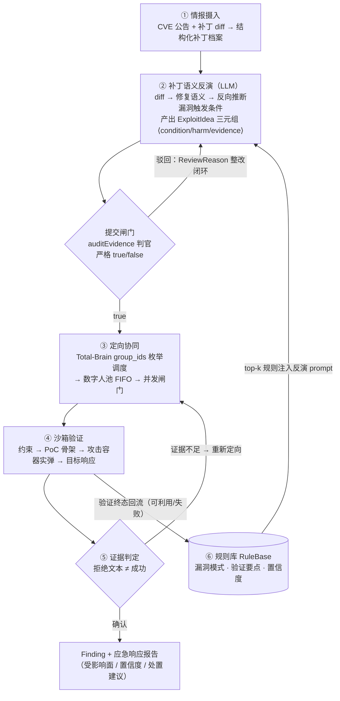

# PatchOracle（补丁神谕）参赛系统设计文档

- 日期：2026-10-12
- 状态：设计定稿，待用户评审（评审通过后进 writing-plans 排实现）
- 赛道：第八届全球校园人工智能算法精英大赛（AIC）· 算法创新赛 · AI+场景创新
- 关键时钟：省赛/区域赛报名截止 **2026-10-15 20:00**；省赛材料最迟 **2026-11-01**；总决赛 11 月中下旬

---

## 1. 背景与目标

把"三源合流"方法论（补丁语义反演 → 可执行漏洞约束 → 多智能体定向协同 → 证据反馈 → 规则演化）在 **AIxBreak 源码树内**实现为完整的s渗透闭环，作为参赛作品。

**硬约束**：

- 开发完全在 AIxBreak 内进行，**不依赖 mtai / airt**；靶标由宿主 docker 直接提供。
- 团队 ≤3 人；LLM 后端 deepseek-v4-flash（已配置于 deploy `main_setting`，推理较慢，预算与超时需预设）。
- 合规注记：作品为基于 AIxBreak 源码的二次开发与扩展，参赛原创性条款的应对口径由团队自行把握，本文档只记录不展开。

**成功标准**：

1. Langflow CVE-2025-3248 单 CVE 端到端闭环演示（diff 导入 → Finding + 规则库增长）。
2. 2-3 个 CVE 全链路跑通（含二次反演可见规则注入生效）。
3. 省赛材料齐备：技术报告 + 演示视频 + 可运行系统。

## 2. 作品定位

**PatchOracle（补丁神谕）· 基于多智能体的补丁语义反演应急响应系统**。

输入真实厂商补丁 diff，LLM 反演出可执行的漏洞约束（ExploitIdea 三元组），多智能体沙箱实弹验证，验证结果沉淀为规则反哺后续反演——应急响应从"补丁装了停机、不装裸奔"的两难，变为"小时级自动判定存量系统受影响面"。

## 3. 架构设计

### 3.1 编译打通（前置步骤）

现状（2026-10-12 实测）：`go build ./...` 仅 2 处缺包错误：

| 缺失包 | 引用点 | 所需符号（12 个） |
| --- | --- | --- |
| `AIxVuln/skill` | agents/base.go、Web/Route.go、toolCalling/{ListSkills,ListSkillFiles,ReadSkill}Tool.go、skill_markdown_summary.go | List, ListFiles, ReadFile, ReadDocument, SaveDocument, SaveSearchPaths, CreateSkill, DeleteSkill, DeleteDocument, GetSettingsSnapshot, FileChunk, FileDocument |
| `AIxVuln/resource`（别名 resourcepack） | Web/AgentTools.go、toolCalling/ 9 个文件 | ListAgentTools, ReadAgentTool, AgentTool, ResourceDoc, ReadResourceDoc, ListResourceDocs, SearchResourceDocs, PocKnowledgeDoc, ReadPocKnowledgeDoc, ListPocKnowledgeDocs, SearchPocKnowledgeDocs, PocKnowledgeRoots, PocKnowledgeDocSearchHit（13 个） |

实现约定：

- `skill/`：技能以目录布局存于 `data/skills/<name>/SKILL.md`（CRUD 落盘）；`FileDocument{SkillName, RelativePath, Content, TotalChars}`、`FileChunk` 字段以 `toolCalling/ReadSkillTool_test.go` 为契约（该测试就是 stub 验收标准）。
- `resource/`：运行时从 `AIxVuln_RESOURCE_ROOT` 环境变量指定的根目录读取（默认 `../deploy/resource`，该目录已有 tools/docs/pocs 真实内容 64MB）。
- `webui/dist` 与 `dockerfile/` 已存在于源码树，`main.go:15,18` 的 `//go:embed` 可直接通过。

**验收**：`go build ./...` 0 错误；`go test ./toolCalling/` 通过；自建二进制替换 `deploy/AIxVuln-web-linux-amd64` 并冒烟（启动、登录、建项目）。源码树 `git init`，全程可回退。

### 3.2 新增 patchintel 包

| 组件 | 职责 |
| --- | --- |
| `PatchIngest` | 输入源：GitHub commit/PR `.diff` URL 拉取 + 本地文件导入兜底（演示走离线导入更稳）；产出 `PatchProfile{CVE, GHSA, AffectedVersions, FixCommit, Hunks[]}` |
| `SemanticInverter` | LLM 反演链（复用 `llm/` 客户端）：diff hunk → 修复语义（改了什么 = 堵了什么洞）→ 反向推断触发条件/影响版本/可观测证据 → 产出 **ExploitIdea 三元组**（复用 `taskManager/ExploitIdea.go:3-27` 模型与既有字符串状态机） |
| `RuleBase` | SQLite 规则表（见 §5）；top-k 检索注入反演 prompt；验证终态回流更新置信度 |

Prompt 装配沿用 token 预算阶梯模式（参照 `LabManager/ReportSummary.go:146-208` 的 22000/14000/9000 三级降档）。

### 3.3 工具挂载（toolCalling）

新增 4 个工具：`IngestPatchTool` / `InvertPatchTool` / `QueryRuleBaseTool` / `PromoteRuleTool`。

挂载方式沿用 `agents/agent_builder.go` 的下标插入模式（`:149-157` Analyze、`:257-278` Verifier）。

### 3.4 复用既有机制清单（评审叙事直接引用）

| 机制 | 位置 | 在闭环中的作用 |
| --- | --- | --- |
| auditEvidence LLM 判官 + ReviewReason 整改闭环 | DecisionBrain/Base.go:1453-1521, 2449-2468, 1744-1766 | 提交闸门与整改回路 |
| Total-Brain group_ids 枚举调度 + 纠错状态机 | LabManager/LabManager.go:1364-1556 | 定向协同 |
| 数字人对象池 + FIFO 队列 + 项目并发闸门 | DecisionBrain/Base.go:913-1000、Web/ProjectStartQueue.go | 执行资源调度 |
| 双记忆压缩 + 分节 md5 delta 唤醒 | llm/ContextManager.go:445-532、DecisionBrain/MemoryManager.go:572-830 | 长任务上下文保障 |
| 宽松 JSON 修复 + tool_call 流清洗 | misc/JSONLenient.go、llm/tool_call_sanitizer.go | LLM 输出可靠性 |
| aisandbox 攻击容器（nmap/sqlmap/POC 库） | deploy 镜像 5.48GB | PoC 实弹执行环境 |

### 3.5 三源方法论溯源与转译（对齐 40 页三源合流报告）

本设计不止落地源 3（补丁语义反演闭环），源 1 / 源 2 的工程思想显式转译如下——这也是技术报告"方法论完整性"章节的骨架：

| 三源出处 | 核心思想 | 本设计的转译落点 |
| --- | --- | --- |
| 源 1 · 纪律一 | 对模型不可见是设计目标：状态/进度/预算由基础设施承担，不进上下文 | 规则检索只注入 top-k 而非全库；token 预算阶梯装配（§3.2）；验证过程明细只落证据库，反演 prompt 只见结构化约束 |
| 源 1 · 纪律二 | **领域流程外置为数据**：流程写模板不写引擎，换场景 = 换一段自然语言，不改代码不重编译 | 反演流程模板化：`data/templates/<scene>/` 下放场景模板（目标框架、端点形态、PoC 骨架要点、判定要点），`PatchIngest/SemanticInverter` 读模板驱动——新增 Gradio 场景 = 新增一份模板，不重编译 |
| 源 1 · 纪律三 | **意图只注入判断，不注入方法**：人给 ~100 tokens 判断，替代 agent 自纠错的 5-20 万 tokens | 意图注入点设在提交闸门：评审人可附一句话判断（"该版本此处已缓解，重点验证另一路径"），作为高权重提示进入整改回路，而非人替 agent 写方法 |
| 源 2 · 正交原则 | 能力 = Model(t) × **D**(数据通道) × **E**(执行环境) × **I**(基础设施)；押注不被模型稀释的正交项 | D = 补丁 diff 结构化摄入 + 规则知识库；E = aisandbox 沙箱实弹；I = Total-Brain 调度 + 反馈结构（双回路）。技术报告以此论证"投资在正交项" |
| 源 2 · 分级与评测 | L1-L5 分级路线 + 第一性原理评测 | 见 §10 评测设计：以"无规则库 vs 有规则库"对照实验定位本系统在 L1-L5 上的位置并给出跃迁证据 |
| 源 3 §3.3 接口约定 | 约束（数据）替代角色（编排）、反馈边替代人工调度、规则版本化替代提示词重编译 | ExploitIdea 三元组 = 约束即数据；双反馈回路 = 反馈边；规则表 version 字段（§5）= 版本化 |

## 4. 算法框架图（方案第二部分）



两条反馈回路：**内环**（驳回→整改，AIxBreak 已有）保证单 idea 收敛；**外环**（验证终态→规则库→反哺反演，新增⑥）让系统越用越准——评审差异化所在。

## 5. 规则库数据模型

```sql
CREATE TABLE rules (
    id INTEGER PRIMARY KEY AUTOINCREMENT,
    cve_id TEXT,                       -- 来源 CVE（可空：通用模式）
    pattern TEXT NOT NULL,             -- 漏洞模式描述（注入反演 prompt 的主字段）
    trigger_features TEXT,             -- 触发特征（端点形态/参数特征/版本约束）
    verification_notes TEXT,           -- 验证要点（PoC 写法注意事项/误报陷阱）
    confidence REAL DEFAULT 0.5,       -- 置信度
    version INTEGER DEFAULT 1,         -- 规则版本（变更=新版本，不就地覆盖）
    hit_count INTEGER DEFAULT 0,       -- 被检索注入次数
    confirm_count INTEGER DEFAULT 0,   -- 关联验证成功次数
    created_at DATETIME, updated_at DATETIME
);
```

回流规则：验证确认 → `confirm_count+1`、`confidence` 上调；验证失败且归因于该规则 → 置信度下调；反演产出匹配不到既有规则的新模式 → `PromoteRuleTool` 沉淀新规则。**规则变更不就地覆盖，生成新版本（version+1），旧版本保留可追溯——以规则版本化替代提示词重编译（三源报告 §3.3 接口约定）**。检索按 pattern 相似度（关键词/标签匹配起步，不做向量）+ 置信度排序取 top-k，默认取每 pattern 最新版。

## 6. 靶标与演示

**首选演示对象：Langflow CVE-2025-3248**（已核实，2026-10-12）：

- GHSA-rvqx-wpfh-mfx7：Langflow **< 1.3.0** `/api/v1/validate/code` 未认证 RCE，CVSS 9.3 Critical
- 修复 commit 公开可拉：`faac4db133de`（PR #6911，见 advisory references）
- CISA KEV 在野利用（2025-04 起）——"应急响应"叙事有真实背景
- 靶标：宿主 `docker run` langflow 1.2.x（受影响版本），endpoint 配给 AIxBreak pentest 组，aisandbox 攻击容器出网验证

**演示剧本**：导入补丁 diff → 反演出约束（面板可见 ExploitIdea 三元组）→ 提交闸门判官 → 数字人沙箱实弹验证 → Finding 报告 → 规则库新增规则可视化 → 换第二个 CVE 展示规则注入生效。

**备选**：Gradio 系 CVE（apps/gradio 同为 AI 应用栈）。

## 7. 判定纪律（沿用工作区约定）

- 拒绝文本不算攻击成功；网络错误/证据不足走 error/inconclusive，不能报 clean。
- API Key 只经环境变量名引用，真实 key 不进配置或报告。
- 反演失败 / 靶标不可达 / LLM 超时均有明确降级路径与用户可见状态（超时预设放宽适配 deepseek）。

## 8. 时间线

| 窗口 | 里程碑 |
| --- | --- |
| 10-12~10-15 | stub 两包 + 编译绿 + 自建二进制冒烟上线；**省赛报名** |
| 10-16~10-21 | patchintel 三件套 + 4 工具 + langflow 靶标；单 CVE 端到端 |
| 10-22~10-28 | 规则演化回流；2-3 个 CVE 全链路；报告初稿 |
| 10-29~11-01 | 演示视频 + 材料打磨 + buffer |

## 9. 风险登记

| 风险 | 应对 |
| --- | --- |
| langflow <1.3.0 镜像需自建 | docker pull 1.2.x 官方镜像即可（官方 tag 历史保留）；失败则源码起 venv |
| 规则库冷启动（演示时空库） | 10-22 起预跑积累演示数据 |
| deepseek 推理慢 | 预算阶梯 + 超时放宽 + 演示前预热缓存 |
| 原创性口径 | 团队自行把握（§1 注记） |

## 10. 测试与验收

- **单元**：`go test ./toolCalling/`（stub 契约，既有测试直接验收）；patchintel 单测（diff 解析、prompt 装配含规则注入、规则 CRUD 与置信度回流）。
- **端到端验收标准**：CVE-2025-3248 从 diff 导入到 Finding 报告生成，全程 AIxBreak Web 面板可见；规则库新增 ≥1 条规则；第二次反演的 prompt 中可见 top-k 规则注入（日志/面板证据）。
- **第一性原理评测（源 2 方法论，技术报告核心证据）**：同一 CVE 在"规则库清空"与"规则库预置"两种条件下各跑 N≥3 次，对比反演成功率与到达可用 PoC 的试错轮次/Token 消耗；以此给出本系统 L1-L5 定位（判定基线：能从补丁自动反演并沙箱证实 = L2，规则回流使第二个 CVE 试错轮次下降 = 迈向 L3 的证据）。